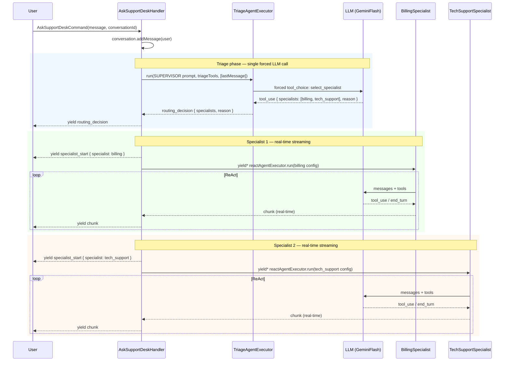

# SupportDesk Agent — Design & Production Readiness

Agent: `AskSupportDeskHandler` + `TriageAgentExecutor` + `ReActAgentExecutor`
Branch: `feat/support-desk-agent`
Autonomy level: L4 (Supervisor forced tool_choice) + L5 (Specialist ReAct loop)

---

## Part 1 — Cookbook: 10 Phases Applied

### Phase 01 — Do you actually need an agent?

- Single LLM call? **No** — customer intent is unknown upfront; the right specialist and tools vary per message.
- Steps fixed and predictable? **No** — billing issues may need `get_invoice` + `issue_refund`; tech support may need `check_service_status` + `create_ticket` after tool results.
- Dynamic decision-making + tool use + unknown steps? **Yes** — agent required.

**Verdict:** Multi-agent system justified.

---

### Phase 02 — Goal and problem

| Question | Answer |
|---|---|
| **Goal** | Resolve routine customer support queries across billing, tech, and account domains without human rep involvement. |
| **Success metric** | Query routed and responded to with at least one relevant tool call; conversation saved for continuity. |
| **Input** | Free-text customer message (string, max 4 000 chars) + `conversationId` (UUID). |
| **Output** | Streaming `AgentStreamChunk` sequence: `routing_decision` → one or more `specialist_start` + ReAct chunks → final `turn_completed`. Conversation persisted in `FileConversationRepository`. |
| **Done / termination** | Each specialist yields `turn_completed { isEnd: true }` after ReAct loop exhausts or resolves. Max turns cap enforced per specialist. |
| **Hard constraints** | 4 000-char input limit. Injection guard on raw message. Max turns per specialist. 1 024-token output cap per LLM call (supervisor output in practice ~50–100 tokens for a tool-call JSON). |
| **Failure mode** | Supervisor ignores forced tool → `TriageAgentExecutor` logs error and returns without yielding `routing_decision` → handler detects `specialists.length === 0` → yields `error` chunk, stream ends. Specialist throws → error propagates to CLI runner (subsequent specialists in list do not run). Save failures logged but non-fatal. |

---

### Phase 03 — Autonomy level

**Supervisor:** Conditional workflow — LLM routes via forced `tool_choice`; paths are engineer-defined (`billing | tech_support | account`). **L4.**

**Specialist:** ReAct loop — tool results determine next step. Steps unknown upfront. **L5.**

Started at the lowest autonomy that works: supervisor is a single deterministic tool call (no loop), specialist runs a bounded loop with `maxTurns`.

---

### Phase 04 — Tools

#### Billing specialist (3 tools)
| Tool | Type | Reversible? |
|---|---|---|
| `get_invoice` | Read | n/a |
| `list_invoices` | Read | n/a |
| `issue_refund` | Write | **No** — money leaves the account |

#### Tech support specialist (3 tools)
| Tool | Type | Reversible? |
|---|---|---|
| `check_service_status` | Read | n/a |
| `get_error_logs` | Read | n/a |
| `create_ticket` | Write | Yes (ticket can be cancelled) |

#### Account specialist (3 tools)
| Tool | Type | Reversible? |
|---|---|---|
| `get_account` | Read | n/a |
| `update_email` | Write | Yes |
| `cancel_subscription` | Write | **No** — subscription ends |

**Tool count:** 3 per specialist — within the 3–5 maximum.

**Shared tools:** None — each specialist has its own isolated tool set. No MCP server needed.

**Data access pattern:** All tools are exact-key DB/API lookups (`get_invoice(id)`, `get_account(id)`). No RAG — corpus is too small and queries are exact.

**Least privilege:** Each specialist only has access to its 3 tools. Supervisor only has access to `select_specialist` (triage tool only, not shared with specialists).

**Write tool protection status:**
- `issue_refund` — currently **no HITL interrupt**. Real production deployment must add `interrupt()` before executing.
- `cancel_subscription` — same. High-stakes write; needs human approval gate.
- `update_email` — lower risk but still a write; prompt requires customer confirmation before calling.

---

### Phase 05 — State and memory

| State | Where stored |
|---|---|
| Current turn messages | `Conversation.messages` (in-memory during handler) |
| Cross-session history | `FileConversationRepository` (`data/conversations/<id>.json`) |
| Agent name scoping | `agentName = 'support-desk'` on `Conversation` entity |

- `Conversation.addMessage()` accumulates — no overwrite.
- Saved incrementally after each `message_added` chunk; final save at stream end.
- `conversationId` scoped per user session — shell's `CONVERSATION_SELECT` / `CONVERSATION_CREATE` flow manages thread identity.
- No sensitive PII stored in conversation body beyond what the customer typed. Logs structured via NestJS Logger.

**Gap:** `FileConversationRepository` is dev-grade. Production needs a durable store (PostgreSQL or equivalent) with encryption at rest for any conversation containing customer data.

---

### Phase 06 — Single agent or multi-agent?

Split justified by three distinct, conflicting responsibilities:
- **Billing:** invoices and refunds
- **Tech support:** outages and error logs
- **Account:** profile and subscription management

A single system prompt covering all three would mix responsibilities → erratic routing and tool misuse.

**Pattern chosen:** Supervisor + specialists (sequential fan-out). Supervisor routes once (no loop, forced `tool_choice`); one or more specialists run as ReAct loops in order, each streaming tokens in real time.

**Why sequential over parallel:** Real-time token streaming per specialist is more valuable than parallel execution speed. Parallel execution requires buffering each specialist's entire output before yielding, which means the user sees nothing until the first specialist finishes. Sequential `yield*` gives the user tokens as the LLM produces them. Total latency is the sum of all specialists, but perceived responsiveness is higher.

**Why multiple specialists:** A customer message can span domains (e.g. "my bill is wrong and my login is broken"). The supervisor selects all relevant specialists; they execute in the order routed.

---

## Execution Flow

### High-level architecture

```mermaid
flowchart TD
    U([User message]) --> H[AskSupportDeskHandler]
    H --> T[TriageAgentExecutor\nL4 — forced tool_choice]
    T -->|routing_decision\nspecialists: string[]| H

    H -->|sequential| B[BillingSpecialist\nReAct loop — L5]
    B -->|real-time chunks| H
    H -->|sequential| TS[TechSupportSpecialist\nReAct loop — L5]
    TS -->|real-time chunks| H

    H -->|specialist_start + chunks\nstreamed as produced| C([Client stream])
```

### Request sequence



### Chunk stream emitted to client

```
routing_decision  { specialists: ['billing', 'tech_support'], reason: '...' }
specialist_start  { specialist: 'billing' }
thought           { text: '...' }
tool_use          { name: 'get_invoice', input: { id: '...' } }
observation       { content: '...' }
text              { text: 'Your invoice ...' }
turn_completed    { isEnd: true }
specialist_start  { specialist: 'tech_support' }
thought           { text: '...' }
tool_use          { name: 'check_service_status', input: {} }
observation       { content: '...' }
text              { text: 'There is currently ...' }
turn_completed    { isEnd: true }
```

---

### Phase 07 — System prompts

One prompt per LLM-powered node (`SUPERVISOR`, `BILLING`, `TECH_SUPPORT`, `ACCOUNT`) in `src/application/constants/support-desk.prompts.ts`.

Each prompt contains:
- **Role** — precisely defined with explicit scope boundaries and exclusions.
- **Tool usage rules** — ordered decision rules (e.g. `"Always call get_invoice before issuing any refund"`).
- **Ambiguity handling** — all specialist prompts instruct the LLM to ask one clarifying question if intent is unclear.
- **Output format** — each prompt includes a `Response format` description and a concrete `Example` response.
- **Confirmation gate** — `issue_refund` and `cancel_subscription` prompts require LLM to seek explicit customer confirmation before calling the write tool.

---

### Phase 08 — Safety and guardrails

**Layer 1 — Input validation (✓ done)**
`AskSupportDeskCommandSchema` (Zod): min 1 char, max 4 000 chars, `conversationId` required.
Validated via `@CommandHandlerWithValidation` before handler runs — zero tokens spent on invalid input.

**Layer 2 — Injection detection (✓ done)**
`validateAndSanitizeInput(msg, UserInputSchema)` in `ask-support-desk.command.ts`. Blocks `ignore previous instructions`, `you are now`, `forget everything`, and 6 other patterns. Applied at command construction — before any LLM call.

**Layer 3 — PII detection on input (✓ done)**
`input.guardrail.ts` blocks credit/debit card numbers (13–19 digit patterns) and SSNs (`\d{3}-\d{2}-\d{4}`). Emails and phone numbers intentionally excluded — customers need them for `update_email` and account lookups.

**Layer 4 — Output PII scan (✓ done)**
`validateOutputText()` in `base-agent-executor.ts` scans every LLM reply before yielding a `text` chunk. Throws if SSN or card number detected in model output.

**Layer 5 — LLM safety classifier**
Not implemented. Acceptable for current scope; add if product moves to untrusted user input at scale.

**max_turns:** Enforced per specialist via `config.maxTurns` (billing: 8, tech_support: 10, account: 6).

**Irreversible writes:** `issue_refund` and `cancel_subscription` have prompt-level confirmation gates but no code-level `interrupt()`. This is the single biggest production gap.

---

### Phase 09 — Error handling and resilience

| Scenario | Current behaviour |
|---|---|
| Supervisor ignores forced tool call | `TriageAgentExecutor` logs `triage_forced_tool_ignored` and returns without yielding `routing_decision`; handler yields `error` chunk and terminates stream |
| Specialist throws during execution | Error propagates through `streamWithPersistence` to CLI runner; subsequent specialists in the list do not run |
| Tool throws / returns error | `ReActAgentExecutor` catches and emits `observation` chunk with error text; LLM can try a different tool |
| Conversation save fails mid-stream | Logged as ERROR; stream continues (non-fatal) |
| LLM rate limit (429) | Handled by `safeInvoke` in Gemini strategy — exponential backoff with jitter |
| max_turns hit | `ReActAgentExecutor` emits `warning` chunk and terminates the loop |

**Gap:** No fallback model for 5xx. If Gemini is down, the entire request fails with a raw exception. Add a try/catch around `createMessage` in the strategy or at the executor level.

---

### Phase 10 — Observability and testing

**What's in place:**
- `@TraceCommand('support-desk')` attaches `traceId` to async context — all logs in a request share the same ID.
- `TriageAgentExecutor` logs `run_complete` with `specialist` keys and `reason` on every routing decision.
- `Logger.error(...)` on supervisor fallback and save failures.
- Gemini strategy logs `gemini_request_sent` and `gemini_response_received` with token counts.
- Tool calls logged via `ReActAgentExecutor` with tool name and input.

**Gaps:**
- No cost-per-run estimation.

**Testing gaps (see Part 2 checklist below for detail):**
- No routing tests yet (`given "my invoice is wrong" → routes to billing`).
- No guardrail rejection tests.
- No edge case / messy input tests.

---

## Part 2 — Production Readiness Checklist

Legend: ✅ done · ⚠️ partial · ❌ gap

### 📋 System Prompts & LLM Configuration

| # | Item | Status | Notes |
|---|---|---|---|
| p1 | Role defined precisely | ✅ | Each prompt names exact specialty and exclusions |
| p2 | Tool usage rules explicit | ✅ | Ordered rules per specialist; ordered tool-use decision rules |
| p3 | Output format shown by example | ✅ | All 4 prompts have `Response format` + concrete `Example` |
| p4 | Forbidden actions listed | ✅ | "You do NOT handle…" in every specialist prompt |
| p5 | Ambiguity handling specified | ✅ | All 3 specialist prompts: "ask one clarifying question before using any tool" |
| p6 | Temperature set appropriately | ✅ | Supervisor: 0.0 · Specialists: 0.1 (pinned per `SpecialistConfig`) |
| p7 | Model version pinned | ✅ | `LlmModel.GeminiFlash` per `SpecialistConfig`; supervisor hardcoded in handler |
| p8 | `max_tokens` set on every LLM call | ✅ | `maxTokens: 1024` on every `createMessage` call (base executor line 362); supervisor outputs ~50–100 tokens in practice (forced tool-call JSON) · `maxTurns` enforced per specialist |
| p9 | Prompts version-controlled | ✅ | `support-desk.prompts.ts` in source control |

### 🔨 Tool Design & Integration

| # | Item | Status | Notes |
|---|---|---|---|
| t1 | Unambiguous docstring on every tool | ✅ | `description` field present on all 9 tools + triage tool |
| t2 | Read/write tools separated | ✅ | Get-* tools are read; issue_refund, cancel_subscription, create_ticket, update_email are write |
| t3 | Write tools validate input | ✅ | Zod schema on each tool's `schema` field |
| t4 | Write tools return structured result, not throw | ✅ | All return `{ success, message }` or typed output |
| t5 | Irreversible writes require `interrupt()` | ❌ | `issue_refund` and `cancel_subscription` execute directly; prompt gate only |
| t6 | 3–5 tools per agent | ✅ | Exactly 3 per specialist |
| t7 | Least privilege | ✅ | Each specialist has its own 3 tools; supervisor has `select_specialist` only |
| t8 | Tool timeouts configured | ❌ | Stub tools are synchronous; real API tools will need timeout wrapping |

### 💾 State Management

| # | Item | Status | Notes |
|---|---|---|---|
| s1 | State schema fully typed | ✅ | `Conversation` entity + `AgentMessage` types |
| s2 | Accumulate vs overwrite reducers | ✅ | `addMessage()` accumulates; no silent overwrites |
| s3 | Conversation history uses safe append | ✅ | `Conversation.addMessage()` + incremental save on every `message_added` |
| s4 | Sensitive fields masked in logs | ⚠️ | No explicit PII masking in logger calls; raw message could appear in `run_start` log |
| s5 | Durable checkpointer for production | ❌ | `FileConversationRepository` — dev only |
| s6 | Thread ID unique per user+session | ✅ | Shell generates UUID per session; `findAllByAgent('support-desk')` scopes list |

### 🔒 Guardrails & Input Validation

| # | Item | Status | Notes |
|---|---|---|---|
| g1 | L1 — basic validation | ✅ | min/max/required via Zod before handler |
| g2 | L2 — injection detection | ✅ | `validateAndSanitizeInput` in `ask-support-desk.command.ts` Zod refine |
| g3 | L3 — PII detection on input | ✅ | Card numbers + SSN blocked in `input.guardrail.ts` |
| g4 | L4 — LLM safety classifier | ❌ | Not implemented — acceptable for current scope |
| g5 | Output validation for PII leakage | ✅ | `validateOutputText()` in `base-agent-executor.ts` scans every reply |
| g6 | `max_turns` set + WARNING on hit | ✅ | `config.maxTurns` enforced; `warning` chunk emitted |
| g7 | Fail fast on invalid input | ✅ | `@CommandHandlerWithValidation` rejects before any LLM call |

### 🔴 Error Handling & Resilience

| # | Item | Status | Notes |
|---|---|---|---|
| e1 | Exponential backoff on LLM rate limits | ✅ | `safeInvoke` in Gemini strategy |
| e2 | Fallback model for 5xx | ❌ | No fallback; Gemini 5xx propagates as exception |
| e3 | Tool calls wrapped, return error object | ✅ | `ReActAgentExecutor` catches tool errors → observation chunk |
| e4 | Graceful degradation on optional tool failure | ✅ | LLM receives error observation and can try another approach |
| e5 | Partial result + explanation on max_turns hit | ✅ | `warning` chunk emitted; stream ends cleanly |
| e6 | User-facing errors are clean | ✅ | `getFriendlyErrorMessage()` in CLI runner maps exception types |
| e7 | Specialist failure handling | ⚠️ | Sequential: if specialist N throws, specialist N+1 never runs; error propagates to CLI runner which shows friendly message |
| e8 | Idempotency for external triggers | n/a | CLI input — no webhook or queue surface |

### ⚡ Streaming & Async

| # | Item | Status | Notes |
|---|---|---|---|
| st1 | Streaming enabled | ✅ | `AsyncGenerator<AgentStreamChunk>` end to end |
| st2 | Stream mode chosen deliberately | ✅ | Real-time token streaming via `generateChunks()` in Gemini strategy |
| st3 | Streaming per specialist | ✅ | Each specialist streams tokens in real time via `yield*`; no buffering |
| st4 | Async in web-serving context | n/a | CLI context — no HTTP event loop concern |
| st5 | Stream error handling on connection drop | ⚠️ | CLI process exit closes the generator; no explicit cleanup hook |

### 🔍 Logging & Observability

| # | Item | Status | Notes |
|---|---|---|---|
| l1 | Structured logging | ✅ | `Logger.log({ event, ... })` object style throughout |
| l2 | Every tool call logged with latency | ✅ | `ToolExecutor.execute()` emits `latencyMs` on every `tool_result` event (success and failure); Grafana picks it up via `unwrap latencyMs` |
| l3 | Every LLM call logged with tokens | ✅ | `gemini_request_sent` / `gemini_response_received` with token counts |
| l4 | Node transitions logged | ✅ | `TriageAgentExecutor` logs `run_complete` with specialist keys + reason |
| l5 | Correlation ID on every request | ✅ | `traceId` via `@TraceCommand` + `getTraceId()` async context |
| l6 | PII masked in all logs | ⚠️ | No masking on raw `message` field before structured log calls |
| l7 | Observability platform configured | ❌ | No LangSmith / Langfuse / equivalent wired up |
| l8 | Alerts for error rate / latency / cost | ✅ | 6 Grafana alert rules: high error rate (CRITICAL), p95 latency > 15 s (WARNING), no runs in 10 min, loop spike, tool timeout spike, API retry exhausted (CRITICAL). No cost alert. |

### 📈 Performance & Cost

| # | Item | Status | Notes |
|---|---|---|---|
| pf1 | Latency targets defined (P50/P95/P99) | ✅ | Grafana dashboard has `quantile_over_time(0.5/0.95/0.99)` panels on `run_complete` events; p95 alert fires at 15 s |
| pf2 | Cost per run estimated | ❌ | Supervisor: forced tool call, ~50–100 output tokens in practice. Specialist: variable — billing maxTurns 8 × (input + output tokens per turn). No formal estimate documented. Estimate before launch. |
| pf3 | Budget alert configured | ❌ | Not configured |
| pf4 | Output tokens minimised | ✅ | Supervisor outputs ~50–100 tokens in practice (forced tool-call JSON); `maxTokens: 1024` is the hard cap. Specialist prompts concise; `maxTurns` bounds total turns. |
| pf5 | Caching for repeated queries | ❌ | No cache — each message hits LLM fresh |
| pf6 | Context window usage monitored | ❌ | `checkAndTrimContext` trims at limit but no budget alerting |
| pf7 | Rate limit headroom planned | ❌ | No TPM/RPM headroom configured |

### 🎯 Testing

| # | Item | Status | Notes |
|---|---|---|---|
| te1 | Tool unit tests | ✅ | 133 tests pass; tools tested with exact expected outputs |
| te2 | Tool selection tests (routing) | ❌ | No test: "given 'my invoice is wrong' → supervisor routes to billing" |
| te3 | HITL enforcement tests | n/a | No HITL implemented yet (see t5 gap) |
| te4 | Guardrail rejection tests | ❌ | No test that injection string or PII input returns rejection |
| te5 | Edge case tests | ⚠️ | Empty / over-limit caught by Zod; multi-part ambiguous queries not tested |
| te6 | Regression suite | ⚠️ | No production bugs yet — add as they occur |
| te7 | Load test | ❌ | Not run |
| te8 | Realistic messy input tests | ❌ | Test suite uses clean formatted strings only |

### 🛡 Security

| # | Item | Status | Notes |
|---|---|---|---|
| sec1 | Threat model documented | ⚠️ | Implicit (injection + PII guards exist) — not formally documented |
| sec2 | API keys in env vars, not code | ✅ | Gemini key via `ConfigService` from env |
| sec3 | User inputs sanitised before prompt inclusion | ✅ | `validateAndSanitizeInput` in command Zod refine; message placed in messages array, not string-concatenated into system prompt |
| sec4 | Tool permissions follow least privilege | ✅ | Each specialist's tool set is isolated |
| sec5 | Rate limiting on agent endpoint | ❌ | CLI — no HTTP rate limiting. Add if exposed via API. |
| sec6 | Audit log of all agent actions | ⚠️ | Structured logs exist; no separate immutable audit trail |
| sec7 | Output filtered for PII/secrets | ✅ | `validateOutputText()` scans every LLM reply before yielding |

### 👤 Human-in-the-Loop

| # | Item | Status | Notes |
|---|---|---|---|
| h1 | `interrupt()` on every irreversible action | ❌ | `issue_refund` and `cancel_subscription` fire without code-level pause |
| h2 | Interrupt payload has full context | ❌ | Not implemented |
| h3 | Mutations show a diff | ❌ | Not implemented |
| h4 | Resume path handles approve + reject | ❌ | Not implemented |
| h5 | Max retry limit on HITL loops | ❌ | Not implemented |
| h6 | Checkpointer configured for HITL graphs | ❌ | `FileConversationRepository` is not a checkpointer |

---

## Priority Gaps for Production

**Critical (block launch):**
1. `issue_refund` and `cancel_subscription` need code-level `interrupt()` / human approval gate — prompt confirmation alone is not sufficient; a determined or hallucinating LLM can bypass it.
2. `FileConversationRepository` → replace with durable store before multi-user or multi-instance deployment.
3. Fallback model for Gemini 5xx errors — currently the entire request fails with a raw exception.

**High (fix soon after launch):**
4. Add routing tests — `given "my invoice is wrong" → supervisor selects billing`.
5. Add guardrail rejection tests — injection string and PII input should return rejection, not reach the LLM.
6. Mask raw `message` field before structured log calls to prevent PII appearing in logs.

**Nice to have:**
8. Estimate and document cost per support interaction (supervisor ~256 tokens + specialist × maxTurns).
9. Add observability platform (LangSmith or Langfuse) for trace trees across multi-agent runs.
10. Add tool timeouts — wrap real API calls in `Promise.race` with a timeout.
11. Formal threat model document covering injection, prompt extraction, and data exfiltration vectors.
